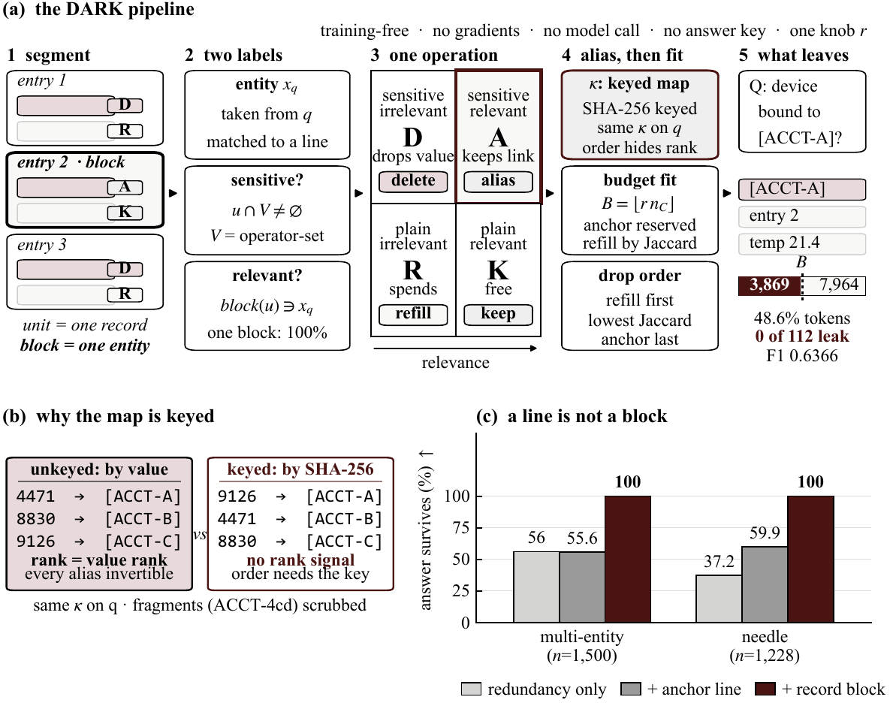

#  PrivTrim

<p align="center">
  
  
  
  
</p>

<p align="center">
  📄 <a href="paper/main.pdf">Paper (PDF)</a>&nbsp;&nbsp;|&nbsp;&nbsp;
  🧪 <a href="demo/index.html">Interactive demo</a>&nbsp;&nbsp;|&nbsp;&nbsp;
  📚 <a href="docs/overview.md">Docs</a>&nbsp;&nbsp;|&nbsp;&nbsp;
  ✅ <a href="docs/reproduction.md">Reproducibility</a>
</p>

**Official repository for _"Keeping the Referent in the DARK: Anchor-Preserving Token Compression for
Privacy-Aware Inference on IoT Logs_".**

**Authors:** Yukun Wen, Shijie Zeng

<sup>1</sup> Department of Computer Science, Khalifa University, Abu Dhabi, United Arab Emirates

<a id="overview"></a>

## Overview

IoT device logs are long, identifier-dense, and routinely pasted into language-model prompts. Such a
prompt is almost always a question about **one named entity** — which device is bound to this
account, which persona id is stored for it. That is the difficulty: the entity the question names is
also the value that must not reach the model.

The two standard remedies each destroy the task in a different way. **Redaction** removes the value
and, with it, the handle the reader needs to tell one of two hundred similar records apart.
**Compression** keeps the handle but drops the record that carries the answer.

PrivTrim shows that in this setting the two goals do not have to be traded. In log-shaped excerpts the
record that *answers* the question and the record that *stores* the protected value are the **same
block** — in 100% of multi-entity cases and 99.7% of needle cases. So keep that block and alias the
values inside it.

<p align="center">
  
</p>

The resulting rule is called **DARK** — **D**elete, **A**lias, **R**efill, **K**eep. It is training-free
and model-free: it makes no gradient step, calls no model, and never reads the reference answer.
Relevance is inferred from the question alone, by locating the record block that contains the queried
entity.

> **What is in here.** The complete project: the method, every benchmark (including the 112-case main
> set and the frozen V1–V3 sample sets), the per-case evidence behind every reported number, the full
> LaTeX source of the manuscript, and the earlier lab-notebook documentation in Chinese under
> [`docs/`](docs/) (`00_执行摘要.md` … `28_…`, plus the original [`README_zh.md`](docs/README_zh.md)).
> [`docs/status.md`](docs/status.md) is the inventory. Verifying the numbers and rebuilding the
> manuscript both run on a CPU.

---

<a id="start-here"></a>

## Start here

| I want to… | Go to |
| --- | --- |
| Read the paper | [`paper/main.pdf`](paper/main.pdf) |
| Understand the method in two pages | [Method](docs/method.md) |
| See the headline numbers | [Results](docs/results.md) |
| Verify the reported numbers on my machine (no GPU) | [Reproduction](docs/reproduction.md) |
| Re-run the reader end to end (GPU) | [Evaluation](docs/evaluation.md) |
| Know what the data files contain | [Data reference](docs/data.md) |
| Run this on a Slurm cluster | [Compute](docs/compute.md) |
| Know what is in the repository | [Status](docs/status.md) |
| Find a specific script | [Code reference](docs/reference.md) |

<a id="finding"></a>

## The finding, in one number

A redundancy-ordered compressor keeps the record that carries the answer about **half** the time — and
the score does not tell you so, because every arm still produces *an* answer:

| Rule for choosing what survives | Answer record retained |
| --- | ---: |
| Redundancy ordering only | 47.5% |
| …plus protecting the anchor **line** | 57.6% |
| …plus protecting the record **block** (DARK) | **100%** |

Protecting the line repairs the pointer, not the content: the account identifier and the answer sit on
*different lines* in 100% of multi-entity cases. The relevant region is a **block**, not a unit.

<a id="results"></a>

## Results

**At scale (2,728 cases, 50% token budget).** DARK is level with the strongest query-aware compressor
and the only arm that leaks nothing:

| Arm | F1 | Protected values recoverable from the prompt |
| --- | ---: | ---: |
| Quito-X (strongest published compressor) | 0.4831 | 98.1% |
| CPC | 0.4740 | 88.8% |
| Provence | 0.4080 | — |
| mask + LLMLingua-2 (nearest *leak-free* baseline) | 0.1712 | 0% |
| **DARK (this work)** | **0.4937** | **0%** |

The F1 gap against Quito-X is +0.0107 with a paired bootstrap interval of \[−0.0091, +0.0306\], i.e.
not significant. The reading is deliberately narrow: a query-aware compressor reaches the same F1 by
forwarding the very value the question names. Among **leak-free** arms DARK is ahead of the nearest
competitor by **+0.3226** \[+0.3041, +0.3414\].

**On the 112-case main set.** Keeping 48.6% of the tokens costs no measurable task quality:

| Arm | F1 | Tokens | Leak |
| --- | ---: | ---: | ---: |
| `full` (no compression, no sanitisation) | 0.7189 | 100% | 100% |
| `alias` (alias everything, no compression) | 0.6475 | 100% | 0% |
| **DARK** | **0.6366** | **48.6%** | **0%** |
| `alias_budget_link` (alias + protect the anchor *line*) | 0.4219 | ~50% | 0% |

DARK vs. `alias` is −0.0109 \[−0.0824, +0.0612\]: halving the prompt costs nothing measurable.
DARK vs. `alias_budget_link` is **+0.2147** \[+0.1224, +0.3085\] — the two differ only in *which
region* survives.

The ordering holds across five budgets (0.10 → 0.75), a second reader (Mistral-7B-Instruct-v0.3), and
two mechanical paraphrases of the question. Full tables: [Results](docs/results.md).

<a id="layout"></a>

## Repository layout

```
.
├── README.md
├── paper/                     manuscript sources + compiled PDF
├── docs/                      English guides + the Chinese lab notebook
│                              (00_执行摘要 … 28_…, README_zh.md, analysis/)
├── src/
│   ├── longctx/               DARK harness, predicate library, quadrant router
│   ├── analysis_quad4/        reproducibility checks (CPU-only)
│   ├── external/              vendored official SQuAD v2 scorer
│   ├── pc_stubs/              import-only stubs for a baseline checkout
│   ├── data_build/            benchmark construction over the source corpora
│   ├── paraphrase_probe/      the motivation study (9.1% paraphrase coverage)
│   ├── mechanism/  tools/  verify/
│   └── *.py                   harnesses, analysis passes, export helpers
├── data/                      every benchmark + MANIFEST.sha256
├── results/
│   ├── percase/               per-case predictions and scores (the evidence)
│   ├── cells/                 per-cell aggregates
│   ├── logs/                  the original job logs, including failures
│   └── reports/               generated run reports
├── demo/                      self-contained interactive demos (no server needed)
├── slurm/                     cluster-neutral job template + shard splitter
├── tests/                     34 CPU-only unit tests
├── assets/                    figures used by this README
├── archive/manuscript-v0/     the superseded earlier manuscript, kept for the record
├── requirements.txt
└── CITATION.cff
```

<a id="quick-start"></a>

## Quick start

Verification needs **no GPU, no model weights, no network and no third-party package** — only
Python 3.10+:

```bash
git clone https://github.com/Yukun-Wen/PrivTrim.git && cd PrivTrim
python src/analysis_quad4/reproduce.py          # re-derive every reported number -> all PASS
python src/analysis_quad4/validate_fallback.py  # model-free routing / budget / leakage check
python -m unittest discover -s tests -v         # 34 predicate and router tests
```

`reproduce.py` reads only `results/percase/` and diffs each of the ~90 reported numbers against its
expected value, so it answers one question precisely: *does the evidence shipped here still produce the
numbers claimed?* It prints `RESULT: all PASS` and exits 0; any mismatch is named and exits 1.

To build prompts without a model:

```bash
gunzip -k data/longctx_max.jsonl.gz
python src/longctx/e2e_quad.py --dry-run --cases data/longctx_max.jsonl \
    --out out/dry.txt --json out/dry.json --percase out/dry_percase.jsonl --limit 20
```

<a id="data"></a>

## Data

| File | Cases | Role |
| --- | ---: | --- |
| [`data/longctx_cases.jsonl`](data/longctx_cases.jsonl) | 112 | **Main set** — main table, budget sweep, cross-model, paraphrases |
| [`data/longctx_max.jsonl.gz`](data/longctx_max.jsonl.gz) | 2,728 | Extension set (scale check) |
| [`data/public_lb.jsonl.gz`](data/public_lb.jsonl.gz) | 300 | LongBench-derived, **topical** questions (no entity named) |
| [`data/public_lb_typeb.jsonl.gz`](data/public_lb_typeb.jsonl.gz) | 300 | LongBench-derived, **single-hop** (entity named) |
| [`data/public_lb_typec.jsonl.gz`](data/public_lb_typec.jsonl.gz) | 300 | LongBench-derived, **two-hop** (answer 6 sentences from the anchor) |
| `data/frozen_samples*.jsonl`, `data/conflict_cases.jsonl`, `data/inscope_*.jsonl` | 581 + slices | the V1–V3 mechanism benchmarks |
| `data/longctx_paraA.jsonl`, `longctx_paraB.jsonl` | 112 each | the two question paraphrases |

All injected sensitive values are **canaries** (`contact.example@…`, `+1-…`, `ACCT-…`), not real
personal data, so leakage is measurable exactly. `data/MANIFEST.sha256` pins all 20 files. Schemas and
caveats: [Data reference](docs/data.md).

<a id="reproduction"></a>

## Reproducing the paper

Three levels, independent of each other:

| Level | What it proves | Cost |
| --- | --- | --- |
| **1. Re-derive the numbers** | The archived per-case evidence yields exactly the reported tables | seconds, CPU |
| **2. Rebuild the arms** | Prompt construction, budget accounting, aliasing and leakage are deterministic and checkable without a model | seconds, CPU |
| **3. Re-run the reader** | The F1 values themselves | 1×7B GPU, ~30 min per arm set |

Levels 1 and 2 run in this repository out of the box and are what CI-style checking would gate on.
Level 3 needs model weights only — every case file it consumes is here. See
[Evaluation](docs/evaluation.md).

<a id="citation"></a>

## Citation

```bibtex
@misc{wen2026dark,
  title  = {Keeping the Referent in the DARK: Anchor-Preserving Token Compression
            for Privacy-Aware Inference on IoT Logs},
  author = {Wen, Yukun and Zeng, Shijie},
  year   = {2026},
  note   = {Preprint, Khalifa University},
  url    = {https://github.com/Yukun-Wen/PrivTrim}
}
```

<a id="license"></a>

## License and data use

No license has been chosen yet. The canary-bearing benchmarks may be redistributed for research use;
the six source corpora they were built from remain under their own licenses. Open an issue before any
commercial use.
