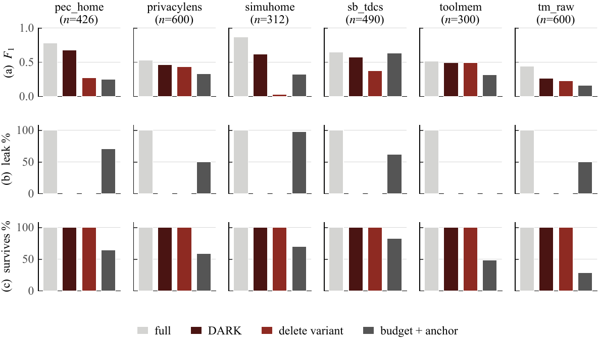

# Results

Every number on this page is re-derivable from the archived per-case results by
`python src/analysis_quad4/reproduce.py` (see [Reproduction](reproduction.md)). The check compares
each value below against its expected value with a tolerance of 0.0015 (fp16 non-determinism level).

Notation: **leak** is the share of cases in which a protected canary is recoverable from the emitted
prompt. Intervals are 95% percentile bootstrap over cases, 10,000 resamples, paired on cases.

## 1. The 2,728-case extension (r = 0.50)

| Arm | F1 | Leak |
| --- | ---: | ---: |
| `full` — no compression, no sanitisation | **0.6081** | 100.0% |
| `ext_full` — uncompressed rerun (identity check) | 0.6078 | 100.0% |
| `quad4` — **DARK** | **0.4937** | **0.0%** |
| `alias_budget_link` — alias globally, protect the anchor line | 0.3482 | 0.0% |
| `budget_cluster_link` — raw text, protect the anchor line | 0.3352 | 55.4% |
| `quad4_del` — DARK with delete instead of alias | 0.3142 | 0.0% |
| `alias_budget` — alias globally, no anchor protection | 0.1469 | 0.0% |
| `budget_cluster` — redundancy ordering only | 0.0981 | 0.5% |

`budget_cluster_link` is the arm that protects the anchor line **without sanitising**, and 55.4%
leakage is what that costs: keeping the block keeps the units that carry the value.

**Published compressors on the same cases** (their own reference implementations; `_native` = the
method's own default length rather than the matched budget):

| Baseline | Family | F1 | Leak |
| --- | --- | ---: | ---: |
| Quito-X | query-aware | 0.4831 | 98.1% |
| Quito-X `_native` | query-aware | 0.4862 | 98.1% |
| CPC | query-aware | 0.4740 | 92.6% |
| CPC `_native` | query-aware | 0.4523 | 93.4% |
| Provence | query-aware | 0.4080 | 90.8% |
| Provence `_native` | query-aware | 0.4047 | 88.8% |
| LLMLingua-2 | task-agnostic | 0.2651 | 100.0% |
| LLMLingua-2 `_native` | task-agnostic | 0.2433 | 100.0% |
| mask + LLMLingua-2 | sanitise + compress | 0.1712 | 0.0% |
| mask + LLMLingua-2 `_native` | sanitise + compress | 0.1663 | 0.0% |
| **DARK** | ours (routes) | **0.4937** | **0.0%** |

Paired differences against DARK:

| Comparison | Δ F1 | 95% CI | Reading |
| --- | ---: | --- | --- |
| vs. Quito-X | +0.0107 | \[−0.0091, +0.0306\] | level; not significant |
| vs. mask + LLMLingua-2 (leak-free) | **+0.3226** | \[+0.3041, +0.3414\] | significant |

The reading is deliberately narrow. A query-aware compressor reaches the same F1 **by forwarding the
value the question names**, which is the one thing this setting forbids. Among arms that keep the
constraint, DARK is 0.32 F1 ahead of the nearest competitor.

The uncompressed arm reproduces the reference value 0.6078 from a separately evaluated batch **to
within one case in 2,728** (0.6081 vs. 0.6078) — the control that says a result set belongs to this
benchmark.

## 2. The 112-case main set (r = 0.50)

`tokens` is the mean compressed-context length; `leak` counts cases in which a protected value is
recoverable from the rewritten question plus the context (see
[leakage counting](#leakage-counting)).

| Arm | F1 | tokens | leak |
| --- | ---: | ---: | ---: |
| `full` | 0.7189 | 7964 | 112/112 |
| `alias` (no compression) | 0.6475 | 7824 | 0/112 |
| **`quad4` — DARK** | **0.6366** | **3869** (48.6%) | **0/112** |
| `delete` (no compression) | 0.4916 | 7845 | 0/112 |
| `budget_cluster_link` | 0.4308 | 3683 | 47/112 |
| `alias_budget_link` | 0.4219 | 3638 | 0/112 |
| `alias_budget` | 0.2232 | — | 0/112 |
| `budget_cluster` | 0.2143 | — | 8/112 |

| Comparison | Δ F1 | 95% CI |
| --- | ---: | --- |
| DARK vs. `alias` (halving the prompt) | −0.0109 | \[−0.0824, +0.0612\] — not significant |
| DARK vs. `full` (the price of the privacy constraint) | −0.0823 | \[−0.1610, −0.0041\] |
| `alias` vs. `full` (the same price, paid without compressing) | −0.0714 | — |
| DARK vs. `alias_budget_link` (the routing decision alone) | **+0.2147** | \[+0.1224, +0.3085\] |

The last row is the comparison specific to this design: both arms are leak-free and compress to nearly
the same length, so the difference isolates *which region survives* — one line, or the block containing
it. It is worth 0.21 F1. Note that `budget_cluster_link`, which protects the same region **without**
sanitising, still leaks in 47 of 112 cases: protecting the block keeps the units that carry the value,
and only the alias step removes it.

## 3. Answer-record retention

What fraction of cases keeps the record that carries the answer, under three selection rules:

| Selection rule | all (2,728) | multi_entity | needle |
| --- | ---: | ---: | ---: |
| redundancy ordering only | 47.5% | 56.0% | 37.2% |
| + protect the anchor **line** | 57.6% | 55.6% | 59.9% |
| + protect the record **block** (DARK) | **100%** | **100%** | **99.7%** |

Two readings matter:

- Multi-entity retention sits either side of the 50% budget cut — what an uninformative ordering
  produces.
- Needle retention is **below** the cut, i.e. worse than uninformative: the answer is a field value
  that recurs across distractors, so the record holding it looks typical and inherits no priority.

Retention alone does not explain F1. The `delete` variant keeps the answer record in 100% of cases and
still scores 0.0000 on multi-entity cases, because the record it keeps no longer says which account it
belongs to. That dissociation is why task quality and leakage are reported as separate endpoints.

## 4. Budget sweep (112 cases, five ratios)

| Arm | r = 0.10 | 0.15 | 0.25 | 0.50 | 0.75 |
| --- | ---: | ---: | ---: | ---: | ---: |
| **`quad4` — DARK** | **0.4357** | **0.4681** | **0.5116** | **0.6366** | **0.6158** |
| `quad4_del` | 0.3297 | 0.3788 | 0.3955 | 0.5205 | 0.5086 |
| `alias_budget_link` | 0.2304 | 0.2052 | 0.2488 | 0.4219 | 0.5512 |
| `budget_cluster_link` | 0.2304 | 0.2052 | 0.2310 | 0.4308 | 0.5576 |

All arms leak 0 at every ratio. DARK is the strongest budget arm at every point: **+0.205** at
r = 0.10, **+0.263** at 0.25, **+0.215** at 0.50, **+0.065** at 0.75. The margin narrows at the loose
end because the budget stops binding there — arms that protect only the anchor line recover from 24.1%
retention at r = 0.10 to 77.7% at r = 0.75 and approach the score the routing rule already reaches.
DARK's own score also dips slightly at 0.75 (0.6366 → 0.6158), because the extra refill text admitted
is repetitive context competing with the relevant block for the reader's attention.

The constraint binds at r = 0.50, and that is where the mechanism separates most clearly.

## 5. Second reader (Mistral-7B-Instruct-v0.3, 112 cases @ 0.50)

| Arm | Qwen2.5-7B | Mistral-7B | Δ on reader change |
| --- | ---: | ---: | ---: |
| `full` | 0.7189 | 0.6931 | −0.0258 |
| `alias` | 0.6475 | 0.5931 | −0.0544 |
| `delete` | 0.4916 | 0.4559 | −0.0357 |
| **`quad4` — DARK** | 0.6366 | **0.6946** | **+0.0580** |
| `quad4_del` | 0.5205 | 0.5520 | +0.0315 |
| `budget_cluster_link` | 0.4308 | 0.3837 | −0.0471 |
| `alias_budget_link` | 0.4219 | 0.3748 | −0.0471 |

DARK is the **only** arm that improves when the reader changes. That is consistent with the mechanism:
a second reader gains more from a cleaned, budgeted prompt than from a long one. On Mistral, DARK
(0.6946) also edges the uncompressed arm (0.6931).

## 6. Question paraphrases (112 cases @ 0.50)

Two mechanical rewritings of the question, pipeline unchanged:

| Arm | original | paraphrase A | paraphrase B |
| --- | ---: | ---: | ---: |
| `full` | 0.7189 | 0.6831 | 0.6575 |
| `alias` | 0.6475 | 0.6297 | 0.6141 |
| `delete` | 0.4916 | 0.4731 | 0.4705 |
| **`quad4` — DARK** | 0.6366 | 0.6637 | 0.6023 |
| `budget_cluster_link` | 0.4308 | 0.3926 | 0.4182 |
| `alias_budget_link` | 0.4219 | 0.3926 | 0.4029 |

Maximum change for DARK is −0.0343, against −0.0614 for the uncompressed arm. The margin over
`alias_budget_link` stays significant in all three conditions (+0.2147, +0.2711, +0.1994). The check
matters because the rule keys on a mention of the queried entity and a rewriting could in principle
disturb it; here it does not.

## 7. Public-benchmark variants (300 cases each)

| Variant | `full` | `alias` | **DARK** | `alias_budget_link` | `quad4_del` |
| --- | ---: | ---: | ---: | ---: | ---: |
| Type A — topical, no entity named | 0.4181 | 0.4074 | 0.3516 | 0.3112 | 0.3503 |
| Type B — single-hop | 0.9889 | 0.9197 | **0.9607** | 0.3100 | 0.1674 |
| Type C — two-hop (answer 6 sentences away) | 0.0967 | 0.7078 | **0.6733** | 0.0167 | 0.0000 |

Three observations:

- **Type A** is outside what the rule addresses. With no entity named there is nothing to route on, so
  DARK degenerates to global aliasing plus redundancy ordering and loses 0.0665 against the
  uncompressed prompt. Reported as such, not as a mechanism failure.
- **Type B** is the operating point the mechanism targets: 0.9607 against 0.9889 uncompressed, with the
  anchor-protecting arm 0.65 F1 behind. `quad4_del` at 0.1674 shows what removing the alias step costs
  here (+0.7933).
- **Type C** is the most informative single result. Without sanitisation the raw prompt scores 0.0967;
  with global aliasing it scores 0.7078. The identifiers in this variant are long hexadecimal strings
  differing in a few characters, so replacing them with short distinct tokens makes the task *easier*
  for the reader. Privacy and utility move in the same direction here — a useful counterpoint to the
  usual framing, though the effect belongs to the identifier surface form rather than to the routing
  rule. Under `quad4_del` the reference answer is still in the prompt after 96.3% of deletions and F1
  is 0.0000: the information is present, the reader cannot use it, and string-presence metrics do not
  detect the failure.

## 8. Refill direction

The traversal direction of the refill queue is an empirical choice, so both are run end to end:

| Benchmark | increasing | decreasing | Δ | 95% CI |
| --- | ---: | ---: | ---: | --- |
| extension (2,728) | 0.4937 | 0.4832 | −0.0106 | \[−0.028, +0.007\] |
| main set (112) | 0.6366 | 0.5844 | −0.0522 | \[−0.124, +0.019\] |
| Type A (300) | 0.3516 | 0.3172 | −0.0344 | \[−0.090, +0.020\] |
| Type B (300) | 0.9607 | 0.9719 | +0.0111 | \[−0.008, +0.032\] |
| **Type C (300)** | **0.6733** | **0.0167** | **−0.6567** | \[−0.712, −0.599\] |

Four of five intervals include zero: away from the boundary the order of refill units does not decide
whether the answer survives. The two-hop benchmark *is* the boundary — there the answer sits six
sentences from the anchor, outside the fallback window, so whether it is present at all is decided by
which units refill admits. Read as a property of this data (the anti-correlation between redundancy and
answer-bearing), not as a guarantee.

## 9. What an answer key would be worth

A rule allowed to read the reference answer gains a great deal from it. On a 300-case stratified
sample, handing the answer span to four redundancy-based arms:

| Arm | Δ F1 from having the answer key | 95% CI |
| --- | ---: | --- |
| `budget_cluster` | +0.2617 | \[+0.215, +0.310\] |
| `alias_budget_link` | +0.2850 | \[+0.233, +0.337\] |
| `budget_cluster_link` | +0.5583 | \[+0.505, +0.613\] |
| `alias_budget_link` (anchor-protected) | +0.5917 | \[+0.535, +0.648\] |

DARK reports every number in this paper **without** that input, because a deployed pipeline holds no
reference answer. Stating the size here fixes the scale of what the rule obtains from the question
alone: the referential benefit is reachable at inference time, not only in an evaluation that still
holds the key.

## 10. Per-source breakdown (extension set, 2,728 cases @ 0.50)

The aggregate 0.4937 is not uniform. F1 by source, all arms of ours constructed without the answer key:

| Source | n | `full` | **DARK** | `alias_budget_link` |
| --- | ---: | ---: | ---: | ---: |
| `pec_home` | 426 | 0.7816 | **0.6756** | 0.2859 |
| `privacylens` | 600 | 0.5340 | **0.4671** | 0.3381 |
| `simuhome` | 312 | 0.8686 | **0.6186** | 0.3910 |
| `smartbench_tdcs` | 490 | 0.6449 | 0.5714 | 0.6367 |
| `toolmem` | 300 | 0.5154 | 0.4933 | 0.3121 |
| `toolmem_raw` | 600 | 0.4401 | **0.2631** | 0.1624 |
| **overall** | **2728** | **0.6081** | **0.4937** | **0.3482** |

The routing rule is strongest on `pec_home` and `smartbench_tdcs` and weakest on `toolmem_raw` — where
the *uncompressed* arm is also weakest, so the difficulty is the source rather than the operation. On
`smartbench_tdcs` the anchor-protecting arm `alias_budget_link` (0.6367) actually beats DARK; it is the
one source where that happens, and it is also the arm that leaks in five of six sources because
protecting the block keeps the units that carry the value.

The same split on the main set (112 cases):

| Source | n | `full` | **DARK** | `alias` |
| --- | ---: | ---: | ---: | ---: |
| `pec_home` | 20 | 0.8750 | 0.8250 | 0.8250 |
| `privacylens` | 20 | 0.6567 | 0.6400 | 0.4900 |
| `simuhome` | 20 | 0.8500 | 0.7500 | 0.7500 |
| `smartbench_tdcs` | 20 | 0.7000 | 0.7000 | 0.6500 |
| `toolmem` | 12 | 0.4901 | 0.4167 | 0.4354 |
| `toolmem_raw` | 20 | 0.6500 | 0.4000 | 0.6500 |
| **overall** | **112** | **0.7189** | **0.6366** | **0.6475** |

  

## Metrics, precisely

**Leakage.** A case counts as leaking when any protected value, or a fragment of it, is recoverable
from the concatenation of the **rewritten question and the compressed context**. Fragments are the
pattern set of the published protocol. The count is **per case, not per value**, so the reported rate
is the fraction of cases with at least one exposure; the per-value count is retained in the artifacts
(`ctx_leak_frag`, `ctx_leak_value`, `out_leak_value` in the per-case rows).

This is why the main-set table above can show `budget_cluster_link` at 47/112 while `alias_budget_link`
is at 0/112: both compress to the same length, but only one of them replaces the values.

**Task quality.** SQuAD v2 `compute_f1` / `compute_exact`, a fixed model-independent procedure, on
greedy 64-token generations from fp16 Qwen2.5-7B-Instruct (seed 20261015).

**Intervals.** 95% percentile bootstrap over cases, 10,000 resamples, paired on cases. A difference is
called significant only when the interval excludes zero. No significance claim is attached to a
comparison across the two benchmark sizes, which draw different cases.

**Tokens.** Measured with the real tokenizer on the emitted prompt, never with a word count.

